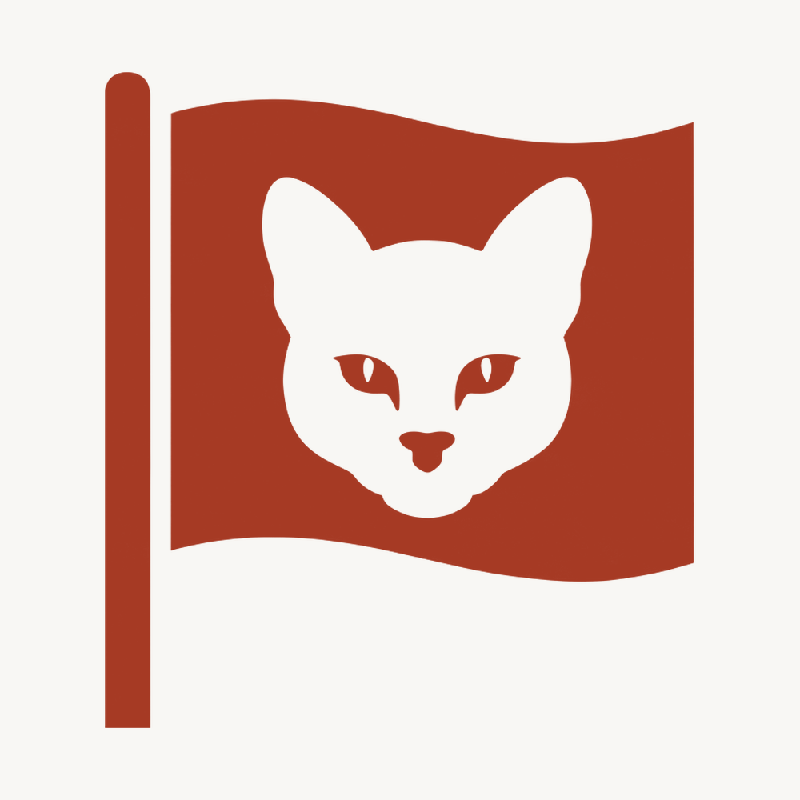

# Brand

The TocaiaCTF mark is a solid flag on a pole, with the head of a Pampas cat cut out of it in
negative. The flag is what every challenge asks you to capture, and the cat is the one lying in
wait for it. It follows the same construction as the marks of
[BagualOps](https://github.com/BagualOps) and [ChimangoScan](https://github.com/ChimangoScan):
one shape, one cutout, two colors.

    
  

| File | Size | Use |
|---|---|---|
| `tocaiactf-logo-alpha.png` | 2400 x 1015 | Horizontal lockup on a transparent background. This is the one to use in READMEs and on the web. |
| `tocaiactf-logo.png` | 2400 x 1015 | The same lockup on the off-white ground, for print and for anywhere transparency is not wanted. |
| `tocaiactf-avatar.png` | 1000 x 1000 | The flag alone, centered on a square. Use it as the organization avatar, and anywhere the name would be too small to read. |
| `tocaiactf-logo-source.jpeg` | 2752 x 1536 | The source image everything else is derived from. |
| `prompt-logo-tocaiactf.txt` | | The prompt that produced the source image. |

Colors, and no third one:

| | Hex | Where |
|---|---|---|
| Ink | `#A63A24` | The flag, the pole, the cat's eyes, and the name |
| Ground | `#F8F7F4` | The background, and therefore the cat cut out of the flag |

The ground is the same warm off-white the other marks of the group use, on purpose: it is what
keeps the marks in one family while the color tells them apart. The derived files carry these
exact values, snapped from what the generator returned.

On GitHub's dark theme the transparent lockup sets the ink against a near-black page at a
contrast of about 2.9:1, and the cat, being a cutout, takes the color of the page. The avatar
keeps the ground for that reason: GitHub crops avatars to a square and fills whatever is
transparent according to the viewer's theme.

Do not recolor the mark, stretch the lockup, put a letter inside the flag, or set the name in a
substitute typeface.
